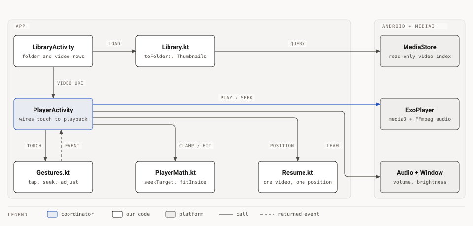
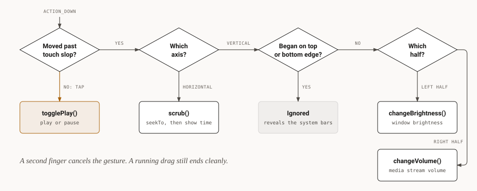

# Architecture

Quiet Player has two screens and a few small files. It uses framework views and Media3 ExoPlayer, with no UI toolkit, so the release APK stays near 2.4 MB.

## How the pieces connect

`PlayerActivity` is the coordinator: it turns touch events into calls on the player, the audio stream and the window. The logic it depends on stays free of Android types, so plain JVM unit tests can cover it.

<picture>
  <source media="(prefers-color-scheme: dark)" srcset="docs/diagrams/architecture-dark.svg">
  
</picture>

| File | Job |
|:---|:---|
| `LibraryActivity.kt` | Asks for permission and shows folders. Started again with a folder path, it shows that folder's videos. |
| `Library.kt` | Queries MediaStore, groups videos into folders, loads and caches thumbnails. |
| `PlayerActivity.kt` | Owns ExoPlayer, the controls, the on-screen meter and system bar hiding. |
| `Gestures.kt` | Turns raw touch points into gesture events. No Android or player types. |
| `PlayerMath.kt` | Pure math for seek targets, level clamping and video fit. |

A file manager can also open `PlayerActivity` directly through its `ACTION_VIEW` intent filter. This reaches files that MediaStore does not index.

## How a touch becomes an action

`Gestures` locks a drag to one action as soon as the finger passes the touch slop. The action cannot change until the finger lifts.

<picture>
  <source media="(prefers-color-scheme: dark)" srcset="docs/diagrams/gestures-dark.svg">
  
</picture>

## Decisions

- **ExoPlayer, not libVLC or mpv.** It adds about 1 MB instead of 20 MB or more. The cost is that video codecs depend on the phone's decoders, and WMV and RMVB do not play.
- **MediaStore, not a file browser.** One narrow permission and instant loading. Folders without videos and `.nomedia` folders do not appear.
- **No INTERNET permission.** The manifest removes it, so the app cannot reach the network.
- **Scrubbing mode while seeking.** `setScrubbingModeEnabled` keeps the picture following the finger during a drag.

## Testing

`./gradlew test` runs the JVM tests for `Gestures`, `PlayerMath` and `toFolders`. The activities and layouts have no automated tests, so check them on a device.
